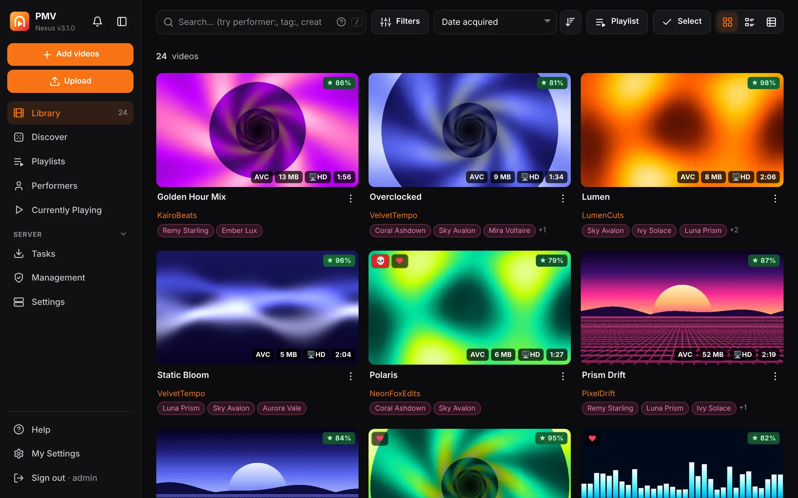
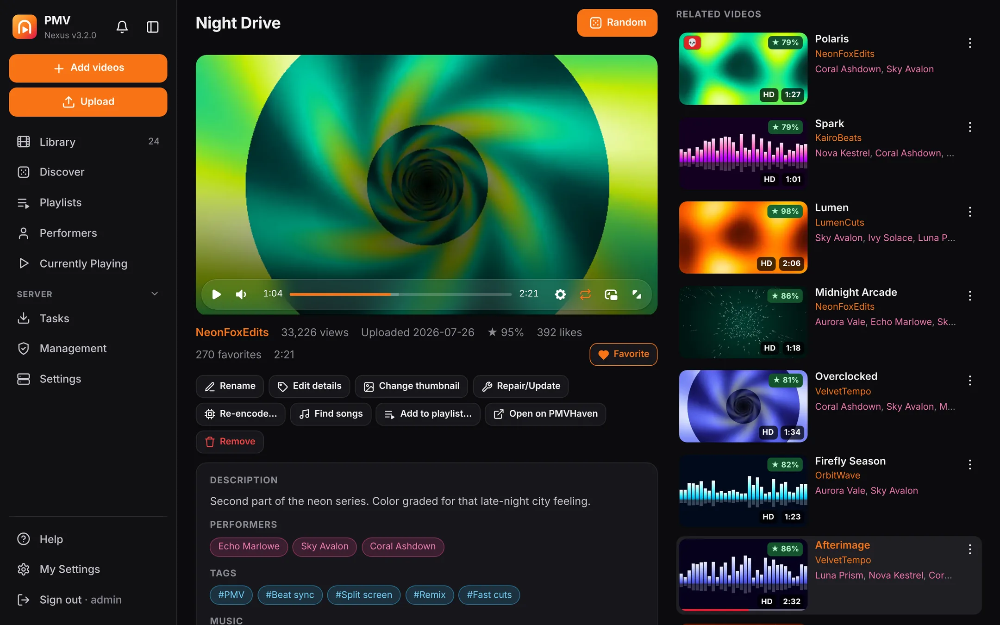
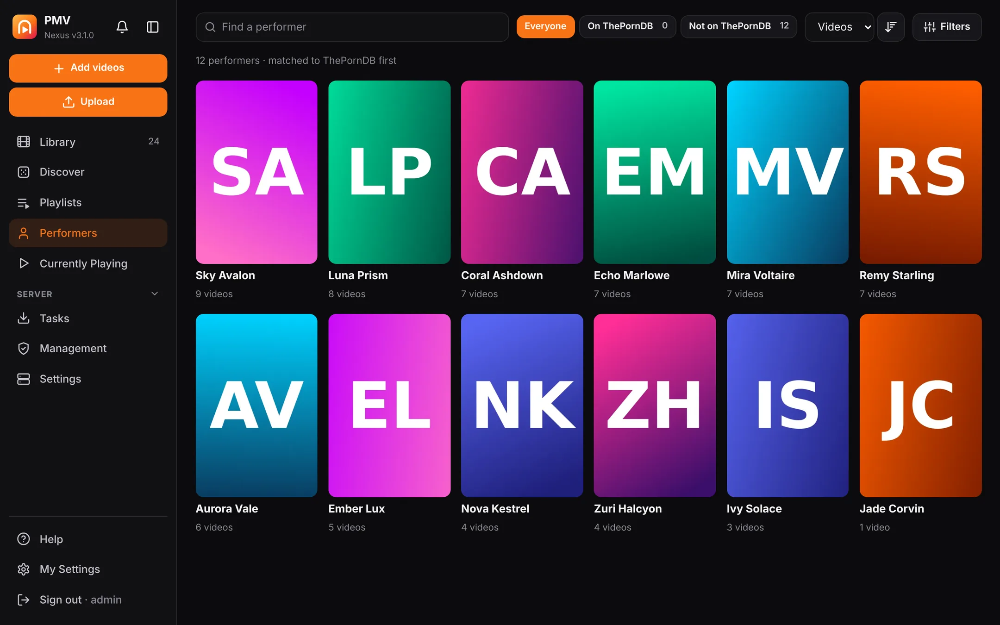
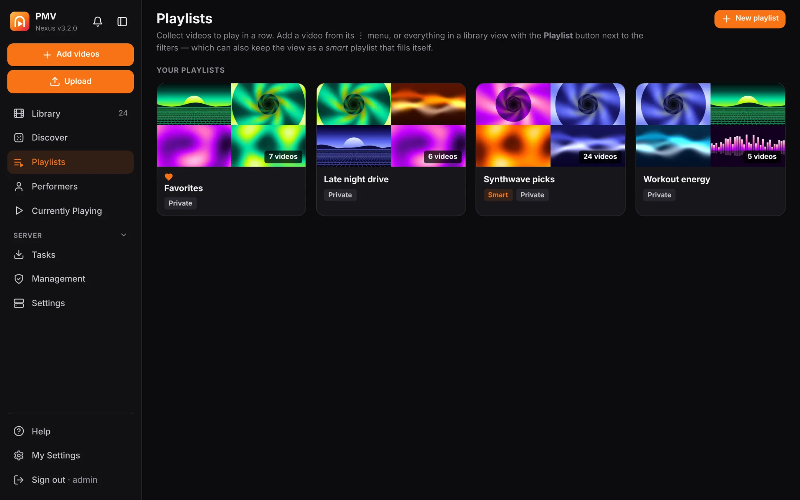
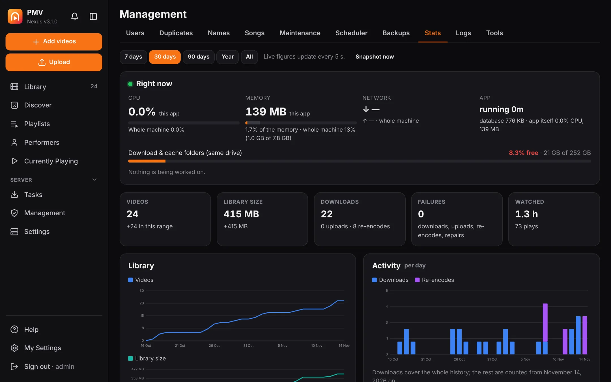
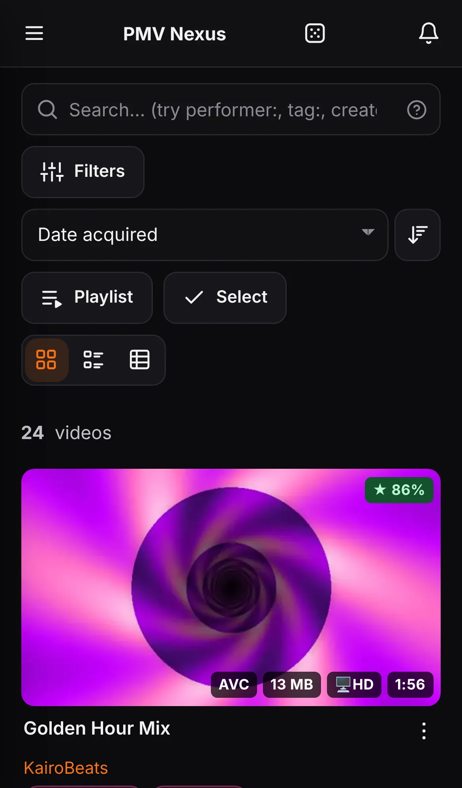
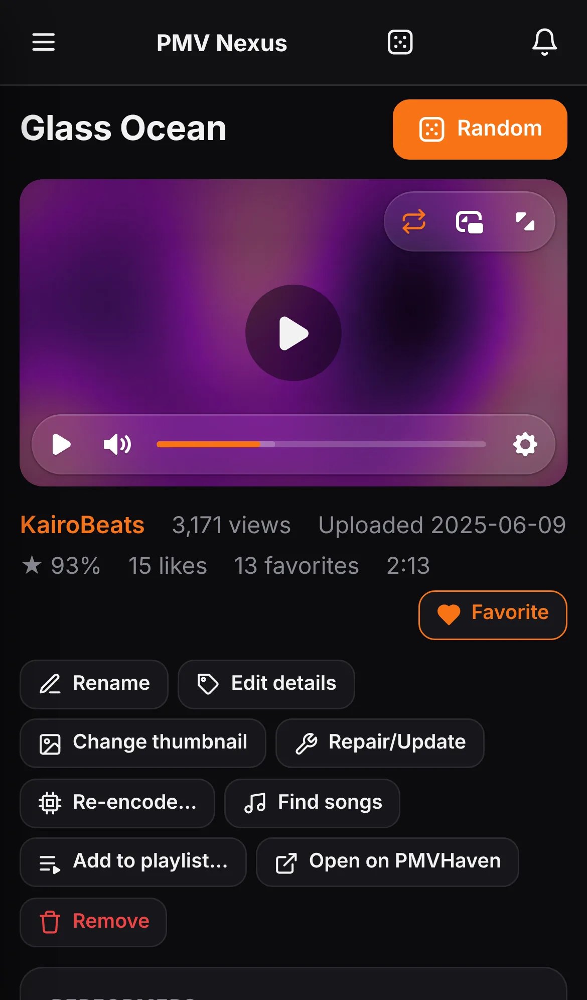

# PMV Nexus


[](https://github.com/edstagdh/PMV_Nexus/releases/latest)
[](https://discord.gg/zphkcKtfTW)

A self-hosted web app for building and managing your own library of PMVs (porn music videos): add a video by its
link, and PMV Nexus fetches its details through the site's official API, downloads it (where the site offers a
download), and keeps it in a searchable, filterable library with a built-in player (with on-the-fly conversion for
slow connections), playlists, ThePornDB performer profiles, song recognition, duplicate detection, HEVC / AV1 / AVC
re-encoding, multiple users and backups. It runs on your own computer or home server and works on phones too.

Works with **PMVHaven** and its sister sites porntubeai.com and hmvhaven.com.

**Open beta.** Download the Windows installer from [Releases](https://github.com/edstagdh/PMV_Nexus/releases), or
see [Installation](#installation) for Linux / macOS. Problems and ideas: [Issues](https://github.com/edstagdh/PMV_Nexus/issues).
Questions, help and news: [Discord](https://discord.gg/zphkcKtfTW).

> **Independent, unofficial project.** PMV Nexus is not affiliated with, endorsed by or connected to PMVHaven or
> any other site it works with. **Adults only (18+).** You are responsible for following each site's terms
> (download only what a site offers for download, for your own personal use) and the law where you live; don't use
> it to redistribute content you have no rights to. It uses each site's official API, doesn't bypass any access
> control, and this project hosts no media. Read the full [Terms of use and disclaimer](DISCLAIMER.md) — installing
> or using PMV Nexus means you accept them.

<p align="center">
  
  
</p>
<p align="center">
  
  
  
</p>
<p align="center">
  
  
</p>
<p align="center"><sub>Screenshots of a demo library: the titles, names, numbers and the abstract videos are made up.
More in the <a href="docs/GUIDE.md">Guide</a>.</sub></p>

---

## Contents

- [Features](#features)
- [Tech stack](#tech-stack)
- [Project layout](#project-layout)
- [Installation](#installation)
- [Configuration](#configuration)
- [Running the app](#running-the-app)
- [Using the app](#using-the-app)
- [Backups & restore](#backups--restore)
- [Data & storage layout](#data--storage-layout)
- [External API (userscript integration)](#external-api-userscript-integration)
- [Notes, limitations & fragility](#notes-limitations--fragility)
- [Troubleshooting](#troubleshooting)
- [Documentation, versions & support](#documentation-versions--support)
- [Code signing policy](#code-signing-policy)
- [Terms of use and disclaimer](DISCLAIMER.md)

---

## Features

### Adding videos
- **Paste links** (one or many) or use the **userscript** on PMVHaven: a button on every video page, and badges on
  every listing for what you already have. Works with PMVHaven and its sister sites porntubeai.com and hmvhaven.com.
- Details come from the site's **official API**: title, creator, upload date, duration, views, rating, description,
  tags, performers, music and content flags. The file comes from the site's own download endpoint, only for videos
  the site offers for download. The app never signs in to a site or reads its pages.
- Thumbnail, hover preview, funscript and a metadata file are saved alongside (each optional).
- **Proxy** (SOCKS5 / HTTP): use it for everything, or **split downloads** so some go through the proxy and some
  direct, at the same time. It has a built-in speed test, and nothing is sent while the proxy is down.
- The **download queue** can be reordered. Failed downloads retry automatically. Downloads pause by themselves when
  the disk is nearly full and resume when there's room.
- **Upload your own videos** with all their details. Each file is checked (type, contents, antivirus, optional
  VirusTotal lookup), then re-packed or converted (AVC / HEVC / AV1) so every browser can play it.

### The library
- **Grid, List and Table** views, with hover previews and badges (duration, quality, codec, size, orientation,
  rating, ♥, removed from the site).
- **Search** every field at once, or one field (`performer:`, `tag:`, `title:`, `creator:`, `music:`, …), with
  `*` wildcards and `"exact phrases"`.
- **Filters:** tags, performers, creators, codec, quality, orientation, rating, a **duration slider** (plus exact
  m:ss boxes), removed from the site, **only without music / performers**, and **performer details** (cup size, age,
  hair, eyes) from ThePornDB. **Exclude** leaves out videos by word or by field (`tag:avc title:downbad`).
- **Saved searches:** save any view (search, filters, exclude, sort) under a name and reopen it in one click.
- **Sort** by date acquired, upload date, title, creator, rating, views, duration, size, resolution, **favourite
  performers** (first or last) or **random** (with Shuffle again).
- **Edit details** of one video or many at once (**Select** → add or remove tags, performers, music). Your edits
  survive syncs.
- **Names:** rename and merge tags, performers and music across the whole library; it suggests likely typos,
  remembers fixes, and shows one spelling per name. Tags and performers are shown capitalised and sorted.
- **Playlists:** manual or **smart** (a saved filter that fills itself), private or shared, with shuffle, repeat
  and autoplay. Everyone gets a private **Favorites** playlist.
- **Discover** (a random video you haven't seen lately), **Currently Playing** (what's being watched right now) and
  **related videos** next to the player.

### Watching
- A full video player with **seekbar previews** (a picture for every moment of the video), optional **frames under
  the player** to jump around, precise volume, loop, speed and keyboard shortcuts.
- **Converting while you watch:** ⚙ → **720p** plays a copy the server converts on the fly (H.264, 720p or 480p).
  It's useful on a slow connection or VPN, and is also used automatically for files a browser can't play.
- **Search this frame:** look up the picture on screen with **Google Lens** or **Yandex** reverse image search
  (add your own sites too).
- **Mini-player:** a playing video keeps going in a floating player while you browse.
- **Phones and tablets:** the whole app works on a phone. In the player, tap to show the controls, double-tap to
  skip, swipe for brightness and volume in fullscreen, and the screen turns to suit each video.

### Performers (ThePornDB, FansDB, StashDB)
- Every performer name is matched to a **ThePornDB** profile: photos, age, measurements, bio, aliases, links and
  similar performers you have. Clear matches link themselves; doubtful ones wait for you to pick.
- **Aliases merge:** different names of the same person show as one, and each performer has a page with all their
  videos. You can add your own photos.
- **Performer badges are coloured by gender** (female, male, trans / non-binary, unknown). For performers who aren't
  on ThePornDB, set it by hand.
- **Favourite performers** (per user): ♥ on their badges, and a library sort that puts their videos first or last.
- **ThePornDB, FansDB and StashDB together:** link a performer to all three, with photos from each (up to 10 site
  photos) and a table of the details the sites disagree on.
- **Recognised by face:** finds performers in videos by comparing the faces in each video's pictures with their
  photos — **completely offline** (OpenCV). Nothing is added without your OK; every decision can be undone.
- **Not on ThePornDB?** Search **FansDB** or **StashDB** by hand, or type their details, links and up to 30 photos in
  yourself — from your computer or from a link the server fetches safely.
- **The Wall:** a 3D (or 2D) graph of who appears with whom; click a performer to see them with all their videos,
  or let **Random** choose one. Nearly every part of it can be set to your liking.

### Songs
- **Find songs:** listens to a video and suggests the songs in it, using **Shazam** (free, no key) and optionally
  **Google Gemini** (AI) for what Shazam misses. Nothing is added without your OK. It works for one video, picked
  videos or on a schedule, and songs show up while the scan runs.

### Keeping the library tidy
- **Sync with PMVHaven:** updates tags, performers, music, ratings and stats from the site, and flags videos the
  site removed (💀). There's a preview first, and your own edits are kept.
- **Duplicate detection:** compares the pictures (perceptual hashes), not just the files. It runs daily and after
  downloads, and you review the pairs side by side. A copy removed as a duplicate can be brought back, or swapped
  with the one that was kept.
- **Shared scenes:** finds videos that use the same footage by comparing their frames, and shows where.
- **Re-encoding:** HEVC, AV1 or AVC (H.264), from any codec to any other. Downscale to 1080p, even keeping the same
  codec (e.g. 8K HEVC → 1080p HEVC). Choose quality and preset, limit CPU use, keep the original if you like.
  A reorderable queue shows live progress, ETA and speed. Each file is checked for damage before it's re-encoded.
- **Repair / update** missing thumbnails, previews and details. **Make audio playable** (AAC) for files with
  audio a browser can't play. Hover previews are made **H.264**, with a graphics card's encoder when it's faster.
  **Untracked files** finds leftovers to delete, and adds videos the library lost track of back without downloading them.
  **Check video files** finds videos whose file is missing, empty or damaged, finds moved or renamed ones again, and
  downloads the rest again.

### Running it
- **Multi-user:** accounts with **roles, groups and per-person permissions** (e.g. a helper who may only fix names).
  Everyone has their own settings, favourites, playlists, saved searches and watch history.
- **Tasks:** everything running, with live progress, Stop buttons and links to the videos involved. A failed task
  links to the log entries from when it ran.
- **Background work takes turns:** heavy jobs share the CPU and the disk video by video, at low priority and within a
  CPU share you set, and give way while someone watches a converted video.
- **Safe upgrades:** a new version changes the library in recorded steps after copying the database; the installers
  say beforehand what an update changes and how long it takes, and an older version never opens a newer library.
- **Scheduler** (daily, weekly, every few hours, one time or cron) for syncs, scans, backups, song finding and more.
- **Notifications** (bell, plus pop-ups) for finished and failed downloads, re-encodes, uploads and jobs.
- **Languages:** the interface and the server's messages in any language that has a file in
  [`languages/`](languages/) — each person picks theirs; admins install them from GitHub (checked against a list of
  SHA-256 hashes) or from a file. Right-to-left languages get a mirrored layout. Adding a language:
  [languages/TRANSLATING.md](languages/TRANSLATING.md).
- **Stats:** live CPU, memory, network and disks; library growth; watching and failures over time.
- **Logs:** every action and change, and every request the app sends out or receives, searchable and exportable.
  Passwords and keys are never logged.
- **Backups:** scheduled (daily and weekly built in) or by hand, optionally password-protected (AES-256), tested and
  restorable from the app; a backup job can also copy each backup to other folders (an external drive, a NAS) and
  upload it, encrypted and without credentials, to a private [Filester](https://filester.me) folder.
  Credentials are stored encrypted.
- **Windows installer** (runs from the tray or as a Windows service), or `install.sh` on Linux / macOS.
  **Update check** built in: published releases only, with a highlighted "New version" notification.
- **Security:** made for a home network or VPN. Sign-in throttling, a strict Content-Security-Policy, cross-site
  request protection, and regular users never see server paths.

### Extensions
Optional add-ons, each a Python package in an `extensions/` folder next to `run.py`. The folder isn't part of
the app and isn't created by it: with no extensions, nothing about them shows anywhere. An extension can add
actions to a video's menu and to the picked-videos bar, settings panels (Server Settings → Extensions),
credentials, permissions, sources, Tasks entries and API routes. It draws no interface of its own: the app shows
the forms it describes. See [Extensions](#extensions-1) below and the comments at the top of `backend/extensions.py`.

### Under the hood
- Single process: one background worker set and one SQLite database (WAL mode), so there's nothing else to run.
  Every write is a per-row upsert, so frequent progress updates stay cheap even with a large library.
- Downloads, re-encodes and queues are rebuilt from the database on every restart, so nothing gets lost in a crash.
- Live updates reach every open browser tab as they happen (Server-Sent Events), with no polling.
- `/api/health` reports the database, FFmpeg and free disk space.

---

## Tech stack

| Layer | Tech |
|---|---|
| Backend | Python, FastAPI, Uvicorn |
| Persistence | SQLite (via a thin custom wrapper — see `backend/db.py`); a second database for rebuildable data (`backend/derived_db.py`) |
| Site access | httpx (the sites' API and downloads) |
| Media | ffmpeg (re-encoding, live HLS conversion, previews, seekbar previews, frames), PyMediaInfo, OpenCV (duration/fps probing; frame hashes for shared scenes, with numpy; face detection and recognition with the YuNet and SFace models) |
| Logging | loguru, with stdlib logging (uvicorn/fastapi/httpx) redirected into it |
| Song recognition | shazamio (Shazam); optional Google Gemini API (AI) |
| Images | Pillow (performer photos stored as WebP) |
| Frontend | Vue 3 + Vite, hand-written CSS, Video.js 10 for video playback, hls.js for converted (720p) streams, three.js with 3d-force-graph / force-graph for the performers' wall |
| Auth | Signed session cookies (itsdangerous) for the web UI; a static API key for external tools |
| Encryption | cryptography (Fernet) for stored credentials, pyzipper (AES-256 zips) for password-protected backups |

---

## Project layout

```
project-root/
├── backend/
│   ├── __init__.py        # entry point — run this to start the server (see "Running the app")
│   ├── main.py             # FastAPI app: all routes, lifespan/startup hook
│   ├── config.py           # settings loader — merges config.yaml + data/settings_overrides.json + encrypted credentials
│   ├── db.py                # SQLite persistence layer for the library
│   ├── library_manager.py  # core orchestration: download/metadata/reencode workers
│   ├── logging_setup.py    # loguru configuration
│   ├── media_tools.py      # ffmpeg re-encoding + HLS download + MediaInfo probing
│   ├── models.py            # Pydantic request/response/domain models
│   ├── pmv_client.py        # site client: API requests + downloads, with your API key
│   ├── pmv_details.py       # site API JSON -> video details + download link (video_meta.py: the details' shape)
│   ├── security.py          # session-cookie auth + API-key auth
│   ├── sources/             # where videos come from (pmv_platform.py: PMVHaven and its sister sites)
│   └── extensions.py        # loads the optional add-ons in extensions/ (see "Extensions")
├── ui/                        # interface source (Vue 3 + Vite) — see ui/README.md
│   └── src/                   # views/ (pages), components/, stores/, lib/, styles/
├── frontend/                  # the built interface (generated from ui/ by `npm run build`, committed)
│   ├── index.html
│   └── assets/                # app.js, index.css, logo.svg, player-lang/ (player translations)
├── run.py                    # start the app (python run.py [--port N] [--restore backup.zip])
├── start.bat / install.bat   # Windows: start the app / console install (optionally from a backup)
├── install.sh                # Linux / macOS install (optionally from a backup, optional systemd user service)
├── installer/windows/        # Setup.exe (Inno Setup script, Windows service definition, icon)
├── .github/workflows/        # release.yml: Setup.exe + GitHub Release per vX.Y.Z tag; translations.yml: checks texts
├── languages/                # en.json (all texts, generated), other languages, manifest.json -- see TRANSLATING.md
├── Tools/                    # helper scripts (first_install, install_extensions, i18n: texts and languages, ...)
├── config.example.yaml       # settings template (committed); copied to config.yaml on first start
├── config.yaml               # your settings — created automatically, not committed
├── requirements.txt
├── extensions/               # optional add-ons -- not part of the app, you create it (see "Extensions")
└── data/                      # created automatically at first run
    ├── library.db              # SQLite database
    ├── backups/                 # backup zips (Management → Backups)
    ├── settings_overrides.json  # settings changed from the UI, layered on top of config.yaml
    ├── logs/                    # rotated backend.log + app_logs.db (Management → Logs)
    ├── pmv_session/             # extensions' saved sign-ins (e.g. Telegram)
    └── cache/                   # thumbnails / previews / metadata JSON (path is configurable)
```

---

## Installation

### Prerequisites
- **Python 3.12–3.14** (`requirements.txt` pins the package versions the app is tested with; they need 3.12 or newer).
- **ffmpeg**, installed and available on your `PATH` — used for re-encoding and HLS remuxing.
- A **PMVHaven API key** (from pmvhaven.com/api-keys) is recommended, so the site knows the requests are yours.

### Windows: Setup.exe (recommended)
Download **`PMV-Nexus-Setup-<version>.exe`** from [Releases](https://github.com/edstagdh/PMV_Nexus/releases)
and run it. Windows may say it protected your PC — the installer isn't code-signed: **More info → Run anyway**.

- **Not code-signed:** PMV Nexus is a free hobby project without a signing certificate, so Windows SmartScreen warns
  about Setup and some antivirus programs may block or remove `PMVNexus.exe` (the small launcher the shortcuts start)
  or files of the app's Python. To check that your download is the released one, compare its fingerprint with the
  `.sha256` file next to it on the Releases page: in PowerShell, `Get-FileHash .\PMV-Nexus-Setup-<version>.exe`.
  If the antivirus takes something, Setup (or the launcher) says so: restore it from the antivirus's quarantine,
  allow the PMV Nexus folder there and run Setup again. You can also report it to the antivirus maker as a false
  positive (Microsoft Defender: [file submission](https://www.microsoft.com/en-us/wdsi/filesubmission)).

- **Just me** (no admin) installs to `%LOCALAPPDATA%\Programs\PMV Nexus`; **all users** (admin) to Program Files
  and also offers the Windows service.
- **How the app runs:** only when you start it (Start-menu shortcut), also when you sign in to Windows, or as a
  **Windows service** (always on, before anyone signs in; Local System can't see mapped drives — use `\\server\share`
  paths or set an account under services.msc → Log On). Optional desktop shortcut. A firewall rule for the port is
  added for private networks (all-users installs; otherwise Windows asks the first time the app starts).
- **Python:** a Python 3.14, 3.13 or 3.12 already on the PC is used (newest first; found through the entries python.org's
  installers make — conda / pyenv ones aren't seen). An app folder whose `.venv` was made with another version gets a new
  one on the next update. If there's none, Setup says so, downloads Python 3.12
  from python.org (checked against the file the release was built with) and installs it — its own progress window shows.
- It then creates `.venv`, installs the packages and, if ticked and
  not already on PATH, **FFmpeg** (in `runtime\`). Details: `data\logs\install.log`; when the install fails, also
  `C:\Logs\PMVNexus-install-<date>-<time>.log` (with Setup's own log; the folder is made when it isn't there).
- **First install:** a new library or **from a backup** (the backup's password if it has one), then the **videos and
  cache folders** (from a backup: where you copied the videos), other folders only if one from the backup can't be
  reached here, and the **port**. Done with Tools/setup_core.py — the same checks as `run.py --restore`.
- **Cancel works at every step**, also while Setup installs Python's packages and on the pages after installing.
  Setup asks first, listing what it will undo, then stops the step and undoes everything this run did: a new
  install is removed (with its shortcuts, the folders it created, the service and firewall rule, and the Python it
  installed); an update puts the previous version back (its code, Python environment and FFmpeg, kept aside until
  the update is done) and starts it again if it was running. Nothing Setup didn't create is deleted.
- **Updating:** run the newer Setup over it — it finds the install by itself (same folder, same options), so choose
  the same "only for me" / "all users" mode as the first time. `config.yaml`, `data`, `extensions` and the service
  setting are kept and the set-up pages skipped. If the app is running (tray, console window or service), Setup says
  so and closes it — work in progress stops safely and continues later — and starts it again afterwards. The app's
  code folders (`backend`, `frontend`, `Tools`, `userscript`, `docs`) are replaced as a whole, so nothing old stays
  behind. Going back to an older version isn't supported (restore a backup instead).
- **Uninstall** (Settings → Apps): removes the app, then asks what else to delete — ticked separately, each with
  its size and folder: the **library database and settings** (`data`, `config.yaml`), **thumbnails, previews and
  frames**, **backups**, and the **videos** (backups and videos are asked again). Nothing ticked keeps everything for
  a later install. Each one is deleted **only in the folder shown for it**, and only the files the app made: anything
  else in those folders stays. Backups saved to other folders (Backups → Save to) are never deleted — the window lists
  them as kept. Deleted files don't go to the Recycle Bin.
- **In Task Manager** the running app is **PMV Nexus** (`PMVNexus.exe`, which runs Python inside it), not
  `pythonw.exe`; a Windows service still runs as `python.exe`.
- **New library:** Setup also creates your **admin account** (username + password) — no setup code needed.
- The Start-menu shortcut starts the app if it isn't running — with a **tray icon**, no console window — and opens
  it in the browser. Setup's **Opening the app** page sets which browser (e.g. a Firefox or Chrome profile) and
  whether starting also opens it (later: Server Settings → Opening the app). "PMV Nexus (console)" starts it with its log window instead, for troubleshooting.

### Linux / macOS: `install.sh`
Get the code (download the release's source zip, or `git clone`), then run **`./install.sh`**: Python check (with the
command to install it if missing), `.venv` and packages, an ffmpeg check, then a new library
(folders + port) or one from a backup zip, and — on Linux with systemd — optionally a **user service**
(`systemctl --user status pmv-nexus`) that keeps it running and starts it with the computer.

### Windows without Setup: `install.bat`
Get the code (`git clone`, or download the zip and extract it), then double-click **`install.bat`**. It checks for
Python, creates `.venv`, installs the Python packages, checks for ffmpeg, and asks:
- **a backup zip** (drag the file into the window) — to set up from a backup, see
  [Setting up from a backup](#setting-up-from-a-backup-new-computer-or-reinstall); or, for a new setup,
- **the folders** — where the videos, thumbnails & previews, sign-ins, database, backups and logs go (Enter keeps
  the defaults inside the app folder; type a number to change one) — and **a port** (Enter = 8676), written to `config.yaml`.

It can be run again any time (e.g. after an update) to install missing packages. The manual steps below do the same
on any OS.

### 1. Get the code and set up a virtual environment
```bash
git clone <your-repo-url> pmv-nexus
cd pmv-nexus
python -m venv .venv
source .venv/bin/activate        # Windows: .venv\Scripts\activate
```

### 2. Install Python dependencies
```bash
pip install -r requirements.txt
```

### 3. Confirm ffmpeg is on your PATH
```bash
ffmpeg -version
```

### 4. Configure the app
The first start creates `config.yaml` from `config.example.yaml`; edit it to set where videos and the cache go
(see [Configuration](#configuration)), and `server.port` to use another port than 8676. `config.yaml` is your own file and is not committed to git. Credentials are
entered in the app after the first start — no `.env` file is needed.

### 5. (Optional) Extensions
If you have extensions, put each one's folder in `extensions/` (next to `run.py`), install their packages and
restart the app:
```bash
python -m Tools.install_extensions
```

---

## Configuration

Non-secret settings live in **`config.yaml`** (created from `config.example.yaml` on first start, not committed); credentials are managed in the app under **Server Settings → Credentials** (stored encrypted). Anything changed under Server Settings is stored separately in `data/settings_overrides.json` and layered on top of `config.yaml` at runtime — you don't need to hand-edit the YAML for day-to-day tweaks.

**Key names in `config.yaml` must match the field names on the corresponding Pydantic model in `backend/config.py` exactly.** Unrecognized keys are silently dropped (Pydantic ignores unknown fields on a plain `BaseModel` rather than erroring), and any field `config.yaml` doesn't set falls back to that model's own default — with no warning that your intended value never took effect. If a setting doesn't seem to be applying, check it against the table below and against `config.py` directly.

### `config.yaml`

| Section | Key | Default | Notes |
|---|---|---|---|
| `server` | `host`, `port` | `0.0.0.0`, `8676` | Where the app listens (read when it starts — restart after changing). `host: "127.0.0.1"` = this computer only. `run.py --host / --port` override them for one run. |
| `sites` | `<key>`: `base_url`, `label` | built in | PMVHaven, PornTubeAI and HMVHaven are built in; add a block only to change one or add another site on the same platform. |
| `download` | `output_dir` | `./downloads` | Where finished videos land, as `<output_dir>/<creator>/<file>`. |
| | `cache_dir` | `./data/cache` | Thumbnails, preview clips, and metadata JSON — kept separate from `output_dir` so the UI stays fast even if your video storage is slow/networked. |
| | `session_dir` | `./data/pmv_session` | Extensions' saved sign-ins. |
| | `library_file` | `./data/library.json` | Legacy flat-file store, only used for a one-time auto-migration into SQLite. |
| | `library_db_file` | `./data/library.db` | The active SQLite database. |
| | `max_concurrent_downloads` | `1` | Parallel video downloads. |
| | `max_concurrent_metadata_fetches` | `3` | Parallel video-details lookups (independent of downloads). |
| | `max_retries` | `3` | Attempts before an item is marked `failed`. |
| | `chunk_size_kb` | `512` | Download chunk size. |
| | `download_funscripts` | `true` | Also fetch the `.funscript` file when present. |
| | `save_metadata_json` | `true` | Write a `<name>.json` metadata file next to every video. |
| `auth` | `session_ttl_hours` | `720` (30 days) | How long the web UI's login cookie stays valid. |
| `logging` | `log_dir`, `rotation`, `retention`, `level` | `./data/logs`, `1 month`, `12 months`, `INFO` | loguru configuration. `rotation`/`retention` must be strings loguru understands (e.g. `"1 month"`, `"500 MB"`) — a plain word like `"monthly"` won't parse. |
| `reencode` | `codec` (`hevc` / `av1` / `h264`), `target_crf`, `preset`, `av1_crf`, `av1_preset`, `h264_crf`, `h264_preset`, `copy_audio`, `downscale`, `cpu_limit_mode`, `cpu_limit_cores`, `cpu_limit_percent`, `remove_chapters`, `keep_original_file` | `hevc`, `24`, `medium`, `32`, `8`, `20`, `medium`, `true`, `true`, `percent`, `4`, `70`, `false`, `false` | Editable under Server Settings → Re-encode (the old `limit_cpu_usage` is read as 70% / off). |

Windows paths like `D:/PH_DATA` work fine — forward slashes are fine cross-platform since everything is read through `pathlib`.

### Credentials (Server Settings → Credentials)

All passwords, API keys and account settings are managed in the app and stored encrypted
(`data/secrets.db`, key in `data/secret.key` — keep the `data` folder private):

| Group | Fields | Purpose |
|---|---|---|
| PMVHaven API | API key | Key from https://pmvhaven.com/api-keys (`pmvh_...`); "Test key" checks it. The same key is used for all three sites. |
| External API | API key | `X-API-Key` for the userscript; Generate / Show / Clear. Empty = external API disabled. |

Extensions can add their own groups here. The session-signing key is generated automatically.

**Upgrading from `.env`:** on the first start of v1.2.0, any values still in `.env` are imported once into the
encrypted store; after that `.env` is ignored and can be deleted.

---

## Running the app

From the project root:

- **Windows:** double-click `start.bat` (uses `.venv\Scripts\python.exe` if present) — runs with its console window.
- **Windows, tray icon:** `.venv\Scripts\pythonw.exe run.py --tray` (what the installer's shortcuts do) — no console:
  - **click the icon** (or **Open PMV Nexus**) to open the app in the browser — the default one, or the program
    set in `config.yaml` → `tray.browser` (e.g. a Firefox profile: `"C:/Program Files/Mozilla Firefox/firefox.exe" -P
    Videos --new-window {url}`); `tray.open_browser: false` = a shortcut that starts the app doesn't open it (both
    also under Server Settings → Opening the app; the browser only from the computer the app runs on);
  - **hover** to see what it's doing ("2 downloads, 1 re-encode, 1 playing");
  - **right-click**: Open, Copy the setup code (only before the first account exists), Open the log folder, Open the
    app folder, **Exit** (asks first when work is running, then stops cleanly — interrupted downloads and re-encodes
    continue at the next start).
  - If a folder can't be reached at start, a message box says which and offers the console window to choose it.
- **Any OS:** `python run.py`.

The port and address come from `config.yaml` (`server.port`, default **8676**; `server.host`, default `0.0.0.0` =
reachable from other devices on your network). For one run only: `python run.py --port 9000` (or
`start.bat --port 9000`). `--restore <backup.zip>` puts a backup back first — see
[Backups & restore](#backups--restore).

`run.py` changes to the project folder first, so it works from shortcuts, `.bat` files and other folders.
It also applies a restore staged on the Backups page before the app loads, and closes open browser tabs'
live-update connections when you stop it. Starting Uvicorn directly
(`python -m uvicorn backend.main:app --host 0.0.0.0 --port 8676`) still works, but ignores `server:` in
`config.yaml`, skips staged restores and may wait for open browser tabs when stopping.

### The interface

The interface's source is in `ui/` (Vue 3); the built files in `frontend/` are included, so nothing extra
is needed to run it. To change the interface itself, see `ui/README.md` (requires Node.js).

### First run
1. On a fresh install the console prints a **setup code**. Open `http://localhost:8676` (or the port you set), enter the code and create the admin account.
2. Enter your **PMVHaven API key** (and any other keys) in **Server Settings → Credentials** (PMVHaven API, from pmvhaven.com/api-keys) so the site knows the requests are yours. The app uses the site's **API only** — video details and the site's own download endpoint; it never signs in to the site or reads its pages.
3. Click **+ Add videos**, paste a `pmvhaven.com/video/...` URL; it appears under **Tasks** while it downloads, then in the **Library**.

---

## Using the app

- **Library vs. Tasks** — Library only ever shows finished downloads; anything still fetching, pending, downloading, or done-but-still-encoding/uploading lives in **Tasks** instead.
- **Views** — admins can switch between Grid, List and Table from the toolbar; other users see the grid.
- **Filters & search** — the Filters panel has tags, performers, creators, codec, quality, orientation, a duration slider, rating, removed-from-site, only without music / performers, performer details and an Exclude box; the search box takes `title:`, `creator:`, `tag:`, `performer:`, `description:`, `music:` prefixes and `*` wildcards. Views can be kept as **saved searches** (🔖); ✕ next to the search box clears the search and the filters.
- **Per-item actions** — from the ⋮ menu or the video page: Edit details, Rename, Change thumbnail, Find songs, Repair / update, Re-encode… (HEVC, AV1 or AVC, with this time's settings), Add to playlist, Remove (plus any extensions' actions).
- **Playlists** — manual (ordered by hand) or smart (filled by a saved library filter), private or public to the app's other users; play in order or shuffled with next / previous, repeat and autoplay.
- **Mini-player** — leave a playing video's page and it keeps playing in a floating, draggable player while you browse; a tab reload brings it back paused at the same moment.
- **Upload** — add videos from your own computer with all their details; thumbnail, preview and technical details are made from the file.
- **Queues** — waiting downloads can be moved to the front/back or up/down on the Tasks page; waiting re-encodes up/down.
- **My Settings** (sidebar) — your own interface preferences. App-wide settings (folders, downloads, re-encode, duplicate scan, credentials, opening the app) are under **Server Settings**.
- **Maintenance** — **Management → Maintenance** has sync from metadata files, sync with PMVHaven, repair everything, seekbar previews, video frames, untracked files and the video file check.
- **Everything else** — performers, songs, names, duplicates, the Scheduler, users and permissions, backups, stats and logs: see the [Guide](docs/GUIDE.md).

---

## Backups & restore

**Management → Backups** makes and restores backups; a weekly backup is a built-in job on the Scheduler page and
the newest 10 are kept (`backup.keep`). The user guide (Help → Guide, or `docs/GUIDE.md`, "Backups") has the full
details and step-by-step scenarios.

**What's in a backup** (one `.zip`, in `data/backups` by default):
- always: the library database (videos and their details, users, roles, playlists, watch history, stats),
  `config.yaml`, the settings changed in the app (`data/settings_overrides.json`), performer photos and playlist covers
  you added;
- optional: **secrets** — the encrypted credentials *with their key* and the saved site sign-ins;
  the thumbnail / preview **cache** (can be large);
- **never the video files.** Copy your download folder yourself (another drive, a NAS).

**Password (encryption).** Set a **backup password** on the Backups page and every new backup — manual or
scheduled — is an AES-256 encrypted zip. Without the password nobody can open it: not the app, not 7-Zip / WinRAR
(which open it *with* the password). Only a small `backup_info.json` (version, date, what's included) stays
readable, so the Backups page can list it. The password is kept in the app's encrypted credential store; it **can't
be recovered** — keep it in a password manager. Restoring or testing a protected backup asks for its password when
the saved one doesn't open it. Recommended for backups that include secrets.

**Restore test.** Each backup is checked right after it's made (and with **Test**): every file intact, the database
passes SQLite's integrity check, the settings can be read, and this app version can restore it.

### Restoring on the same install
**Restore** next to a backup, then restart the app (`start.bat` / `run.py`) — in a console window, since it shows
the backup's folders to check (as in step 2 below); without a console, a restore whose folders can't be reached
waits for one. Nothing changes until the restart;
**Cancel the restore** calls it off. Every file the restore replaces is kept as `<name>.pre-restore` (e.g.
`data/library.db.pre-restore`) — to undo, stop the app and rename them back. After a restore you sign in with the
accounts from the backup.

### Setting up from a backup (new computer or reinstall)
1. On the old install: **Create backup now** (tick **Include secrets** to keep credentials and extensions' sign-ins), then
   **Download** it, or copy it from `data/backups`. Copy the **download folder** with the videos too.
2. On the new computer, get the code, then either
   - **Windows:** double-click `install.bat` and drag the backup zip into its window when asked; or
   - **any OS:** install as above, then start once with the backup:
     ```bash
     python run.py --restore path/to/pmvnexus_backup_20261112_120000.zip
     ```
     (`start.bat --restore "D:\backups\pmvnexus_backup_….zip"` on Windows.)

   A password-protected backup asks for its password in the console. Then the console lists the **folders from
   the backup's settings** — videos, thumbnails & previews, sign-ins, database, backups, logs — and whether each
   is there on this computer. A folder that can't be reached (e.g. drive `D:` doesn't exist here) has to be given a
   new place; any other can be changed by typing its number (e.g. where you copied the videos); Enter keeps them.
   The restored files go to the new places, the new places are saved in `config.yaml`, and at the start the app
   finds the videos, thumbnails and previews in them (by `<creator>/<file>`, so the old paths don't have to match).
   The app then starts with the restored library, settings and accounts — on the port in the backup's
   `config.yaml`. No setup code or temporary account is needed.
3. Check **Management → Tools** (ffmpeg and packages), and **Server Settings → Credentials** if the backup had no
   secrets.

### Backups from other versions
- **Older backups restore into newer versions.** Every backup since 1.2.0 can be restored as is: when the app
  starts after the restore it brings the database up to date (adds the tables and columns added since) and reads
  settings saved under old names. Tested with backups made by 1.2.0, 1.10.0, 2.0.0, 2.10.0 and 2.17.3.
- **A backup made by a newer version is refused** by an older app ("Update the app first, then restore it") — an
  older app can't know what the newer one changed. Update the code, then restore.
- Password-protected backups (2.25.0+) need the `pyzipper` package (in `requirements.txt`).

**Folders that can't be reached at a start** (e.g. the videos drive isn't plugged in): `run.py` stops before
loading the app and lists them; in a console window it asks for their new place (saved in `config.yaml`, and the
app looks for the files there), otherwise it says which setting to fix.

---

## Extensions

Extensions are optional add-ons kept outside the app's code. Each is a folder in `extensions/` (next to `run.py`)
with an `__init__.py` that has a `register(api)` function, and optionally a `requirements.txt`:

```
extensions/
└── my_extension/
    ├── __init__.py        # def register(api): ...
    └── requirements.txt   # its Python packages (optional)
```

- **Install:** copy (or `git clone`) the folders into `extensions/`, run `python -m Tools.install_extensions`
  with the app's Python (the Windows Setup does this itself when it finds the folder), restart the app.
- **Remove:** stop the app, delete the extension's folder, start it again. Its data on videos stays in the
  database, unused, and comes back if you reinstall it.
- **See them:** Server Settings → **Extensions** (only there when at least one is installed): what's loaded or
  failed (the log says why), and their settings panels. Their actions appear in a video's menu and in the
  library's picked-videos bar; their credentials under Server Settings → Credentials; their permissions under
  Users → roles.
- **Write one:** the API (`ExtensionAPI`) and the form format are described at the top of
  `backend/extensions.py`. A broken extension is skipped; the app runs without it.

## Data & storage layout

```
data/
├── library.db                 # SQLite database — the source of truth for the library
├── derived.db                 # rebuildable data: shared-scene fingerprints, faces found (3.12.0)
├── backups/before-upgrade/    # a copy of library.db before each upgrade step (the last 3)
├── settings_overrides.json    # UI-changed settings, layered over config.yaml
├── logs/
│   └── backend.log            # rotated monthly, kept for 12 months, rotated files zipped
├── pmv_session/               # extensions' saved sign-ins (e.g. Telegram)
└── cache/                      # (path from config.download.cache_dir)
    └── <creator>/               # thumbnails, preview clips, metadata JSON
```

The performer-photo folders and the generated-files folder (seekbar previews, frames) can be moved elsewhere
(Server Settings → Download). The face models live next to the app in `models/faces/` (not in the repository:
`python -m Tools.get_face_models` downloads them and checks their SHA-256; Setup.exe includes them).

Downloaded videos themselves go to `<output_dir>/<creator>/<creator> - <upload date> - <title> [<id>].<ext>`, with matching sidecars (`.funscript`, `.json`) alongside. A re-encode backs up the pre-encode metadata as `<name>_original.json`, and — if "keep original file" is on — the pre-encode video as `<name>_old.<ext>`.


---

## External API (userscript integration)

These endpoints authenticate via a static `X-API-Key` header (generate the key in **Server Settings → Credentials → External API** to enable them) instead of the cookie-based session, for tools like a browser userscript that can't hold a login session:

- `POST /api/external/library` — body `{"url": "..."}`, adds a video to the library.
- `GET /api/external/exists?url=...` — returns `{"exists": bool, "status": ..., "title": ..., "label": ...}` for dedupe checks before adding (an item that previously `failed` is reported as not existing, since it's re-addable). A duplicate removed on the Duplicates page has `status: "merged"` and `duplicate_of: {id, title, url}` (the copy that was kept).
- `GET /api/external/index` — `{"generated_at", "done": [ids], "merged": {id: {"of", "title"}}}`: every downloaded video's id (the 24-character id at the end of a PMVHaven video URL) and every removed duplicate, so a client can keep its own copy instead of asking per video.

The userscript itself is in [`userscript/pmv-nexus.user.js`](userscript/pmv-nexus.user.js) — install it in Tampermonkey/Violentmonkey
(open the [raw file](https://raw.githubusercontent.com/edstagdh/PMV_Nexus/main/userscript/pmv-nexus.user.js) with
the extension installed and it offers to install it; it then updates itself from there); it asks for the app's URL and the API key on first use (change them later from its menu: **Change PMV Nexus Address / API Key**). The Windows installer puts the chosen port in its default address. It keeps a copy of the downloaded list (synced daily, or via its menu → **Sync Downloaded List Now**), marks downloaded videos and duplicates on every listing, and adds a download button on video pages.

---

## Notes, limitations & fragility

- The sites are used through their API only: if PMVHaven changes its API, `backend/pmv_details.py` (reading the details), `backend/pmv_api.py` (sync) and `backend/sources/pmv_platform.py` are the places to look.
- Live updates use Server-Sent Events; a browser that loses the connection shows "Can't reach the server" and catches up by itself when it's back.
- This is designed around a single instance with one SQLite file — it isn't built for multiple concurrent installs sharing one database.

---

## Troubleshooting

- **A setting in `config.yaml` doesn't seem to apply** — the key name almost certainly doesn't match the corresponding Pydantic field in `backend/config.py`; unmatched keys are dropped silently. See the note in [Configuration](#configuration).
- **`ModuleNotFoundError: No module named 'cv2'`** — install OpenCV separately: `pip install opencv-python` (see the note in [Installation](#installation)).
- **Re-encode/HLS download fails immediately** — confirm `ffmpeg -version` works from the same environment the app runs in; `/api/health` also reports whether `ffmpeg` is on `PATH`.
- **A video won't download ("the site didn't give the file" / "the API didn't return this video")** — it's private, removed, or not offered for download on the site; check that your API key is saved (Credentials → PMVHaven API → Test key).
- **Can't delete a file on Windows** — the app already retries deletion a few times to ride out the video player holding a stream open; if it still fails, make sure the video isn't open in another program.

---

## Documentation, versions & support

- In-app **Help** menu: Guide (`docs/GUIDE.md`), Changelog (`CHANGELOG.md`) and About.
- The current version is in `VERSION`; click the version label in the header to check for updates.
- Report bugs at <https://github.com/edstagdh/PMV_Nexus/issues> (Help → Report an issue prefills one).
- Questions, help and release news: the [PMV Nexus Discord](https://discord.gg/zphkcKtfTW).
- Security problems: please report them privately — see [SECURITY.md](SECURITY.md).

### Making a release (maintainers)
Releases are built by GitHub Actions (`.github/workflows/release.yml`) — nothing to build locally:
1. Update `VERSION` and the `CHANGELOG.md` section for it; commit and push.
2. Tag the commit and push the tag: `git tag v3.2.0 && git push origin v3.2.0`.
3. The **Release** workflow checks that the tag matches `VERSION`, compiles the Python code, downloads WinSW and checks
   the Python installer's signature, downloads the face models (checked by SHA-256), builds `Setup.exe` with Inno Setup, and publishes a GitHub Release with the
   `.exe`, its `.sha256` and the release notes (the source zip is added by GitHub). The notes are every CHANGELOG
   section newer than the previous release tag, so versions that were never tagged on their own (e.g. 3.4.2 when
   tagging 3.5.0 right after 3.4.1) are included, newest first.
4. If Discord is set up, it renames the server's version channel to "📦 Latest: v<version>". This needs the
   repository secret `DISCORD_BOT_TOKEN` (a bot with *Manage Channels* on that channel) and the repository variable
   `DISCORD_VERSION_CHANNEL_ID`. Without them the step is skipped, and a Discord problem never fails the release.

The **Upgrades** workflow (`.github/workflows/upgrades.yml`, every push and pull request) makes a library with 3.6.0,
the newest release tag and the previous commit — each with its own code and packages — and opens it with the new
code (`Tools/upgrade_ci.py`): nothing may be lost. A change to how the library is stored is a new step in
`backend/upgrades/steps.py`.

To try the installer without releasing: **Actions → Release → Run workflow** — the `.exe` is attached to that run
as an artifact. To build on a Windows PC instead: install Inno Setup 6, put WinSW-x64.exe at
`installer/windows/build/PMVNexusService.exe`, and run `iscc installer\windows\PMVNexus.iss`.

## Code signing policy

Windows releases are built from this repository's source by GitHub Actions (`.github/workflows/release.yml`) —
never on a personal computer — and published on the [Releases](https://github.com/edstagdh/PMV_Nexus/releases)
page with their SHA-256 checksums.

- **Signing:** releases are not code-signed yet (Windows shows "Windows protected your PC": **More info → Run
  anyway**; check the download against its `.sha256` if you like). When they are, this section will say who
  provides the certificate.
- **Who:** committer, reviewer and release approver: [edstagdh](https://github.com/edstagdh). Every signed release
  is approved by hand.
- **What's installed:** the app and its Python packages (from PyPI), and — when they're missing — Python from
  python.org (its signature and checksum are checked when the installer is built) and FFmpeg (gyan.dev, optional).
- **Privacy:** PMV Nexus sends nothing to this project. It talks to the sites you add videos from (with your API
  key), and only when you use them: Shazam (sound samples), Google Gemini (sound clips, with your key), ThePornDB,
  VirusTotal, the proxy test (ipify, Cloudflare's speed test), and GitHub to check for a newer version.

## License

MIT, see [LICENSE](LICENSE).
